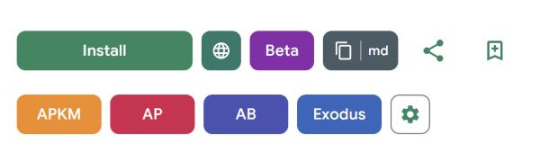
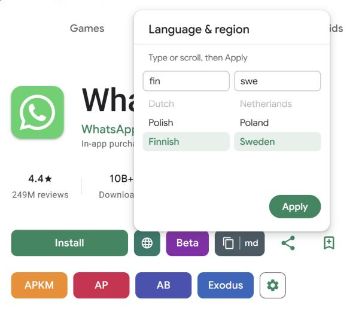
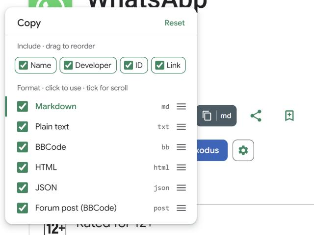

Adds a row of handy buttons to every Google Play app page and search result, right next to Google's own Install button. Nothing is sent anywhere until you click a button.

## Buttons

- **Globe: language and country.** Scroll over it to change country (Shift + scroll for language), or click it for two small wheels with search boxes. Pick *Default* to go back to Google's own choice.
- **Beta:** the app's beta testing page.
- **Copy:** copies the app's name, developer, ID and link in the format you pick: Markdown, plain text, BBCode, HTML, JSON or a ready-to-post forum block. Scroll over it to switch format; right-click (or hold, on a phone) to choose what is included.
- **APKM, AP, AB, Exodus:** APKMirror, Android Police, AppBrain and the Exodus Privacy report for the same app.
- **Gear:** drag the buttons into any order (Google's Install, Share and Wishlist too), hide the ones you don't use, and add line breaks.

## Also

- Links that go through Google's redirector are pointed straight at their destination.
- Screenshot galleries get a thin scrollbar.
- Works on phones and in dark mode, and matches Google's own buttons.

## Privacy

No tracking, no accounts, no network requests of its own. The language setting only reloads the page with `hl=` / `gl=` added to the address. Your settings are stored by your userscript manager.

[Source and issues on GitHub](https://github.com/AryanBhanot/monkey-business)
